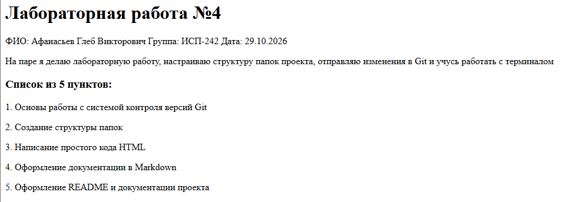
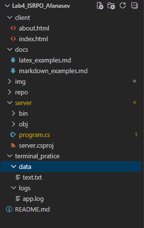
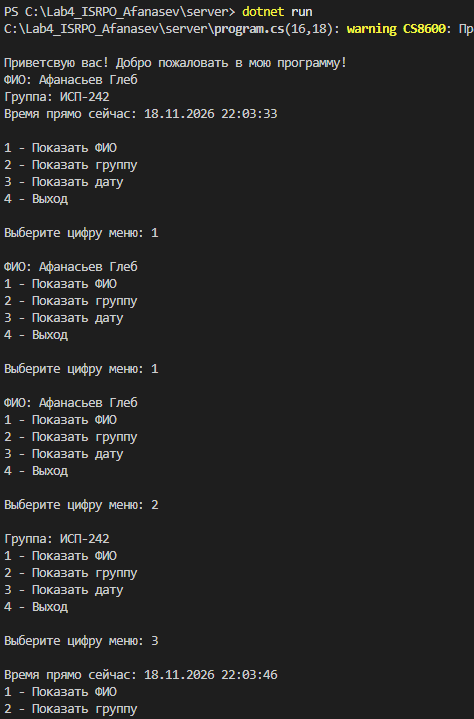

# Лабораторная работа №3

**ФИО:** Афанасьев Глеб Викторович

**Группа:** ИСП-242

**Дата:** 30.10.2026

## Описание проекта

Данный проект представляет собой лабораторную работу №4, в рамках которой были закреплены практические навыки работы с системой контроля версий **Git**, языком разметки **Markdown**, командной строкой (терминалом) и организацией структуры проекта.

## Содержание

1. [Описание проекта](#описание-проекта)
2. [Структура проекта](#структура-проекта)
3. [Примеры Markdown](#примеры-markdown)
4. [Пример LaTeX](#пример-latex)
5. [Репозиторий](#репозиторий)
6. [Скриншоты](#скриншоты)
7. [Заключение](#заключение)

## Структура проекта

* `repo/` - скриншоты
* `server/` - пример кода C#
* `README.md` - основной файл
* `docs/` - файл с MarkDown
* `terminal_practice/` - работа с терминалом
* `client/` - пример кода HTML

## Примеры Markdown

### Заголовок

## Список

* Markdown
* Git
* LaTeX

### Картинка



### Код

```csharp
Console.WriteLine("Hello, World!");
```

## Пример LaTeX

Inline-формула: $a^2 + b^2 = c^2$

Блок-формула:

$$
\sum_{i=1}^n i = \frac{n(n+1)}{2}
$$

## Репозиторий

[Мой репозиторий на GitHub](https://github.com/Fraay/Lab4_ISRPO_Afanasev)

## Скриншоты

### Структура


### Рабочая программа в терминале



## Заключение

В ходе выполнения лабораторной работы №4 я получил навыки:

* создания и ведения GitHub-репозитория;
работы с Git (частые коммиты, push, история изменений);

* использования Markdown для оформления документации;

* работы с терминалом (создание, копирование, переименование и удаление файлов);

* организации структуры проекта (frontend, backend, docs, repo);